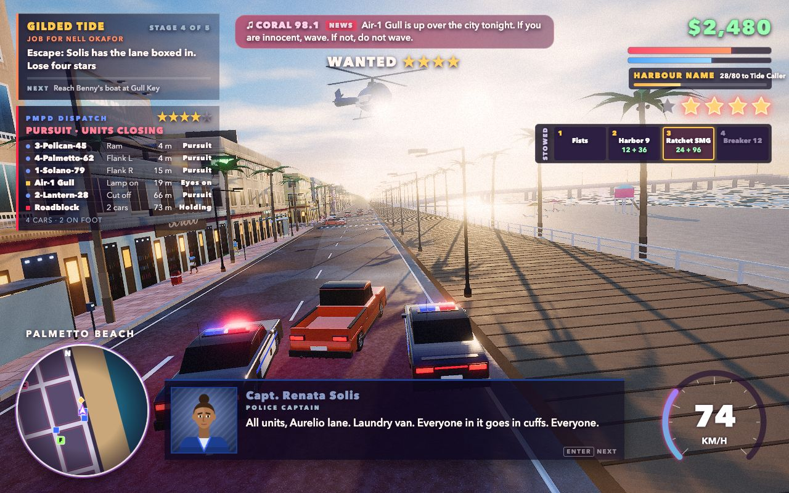

# Meridian Coast

[](https://make.fun/c/gta6-01)
[](https://make.fun/c/gta6-01)
[](https://make.fun/c/gta6-01)

An original open-world crime game set in Port Meridian, a neon coastal city at dusk. You play an ex-courier who
has forty grand of debt and no friends he can trust. It runs in desktop Chrome from plain static files.



## Run it

```sh
node serve.ts
```

Open <http://localhost:8080> in desktop Chrome and press Enter. You need Node 22 or newer to run the server. The game
has no build step and makes no network requests. Every texture, model and sound is generated in the browser when
the game loads.

## Controls

| Key | On foot | In a car |
|---|---|---|
| W A S D / arrows | move | drive |
| Shift | run | |
| Space | | handbrake |
| C | crouch | |
| E | enter a car, use a shop, meet a contact at a gold pillar | get out |
| Mouse (click to lock) | look and aim | look around |
| Q / F or click | aim / fire | |
| 1–4, Tab, R | pick a weapon, next weapon, reload | R changes the radio station |
| P | phone: jobs, activities, the next rank | |
| N | full city map (drag or WASD to pan, wheel or +/− to zoom, Space finds you) | |
| M, Esc | mute; pause, progress, settings, save | |
| Enter, Backspace | skip a line or retry a failed job; call a failed job off | |

## The story

1. Ilo Rask owes the loan shark Gus Pell forty grand. Nell, the fixer at the Lucky Lantern, gives him courier work.
2. He steals the harbour boss Harlan Voss's coupe, tails a Salt Dogs van to the cold store and finds police
   permits.
3. Captain Solis offers him a clean record for Voss. Priya's Calder Crew and Benny the boatman want favours too.
4. Nell turns out to be selling his routes to Gus, and Voss's driver Dex hands over the yard keys.
5. The heist under the Hotel Aurelio pays everyone off. Solis wants the crew in cuffs, so Ilo leaves on Benny's
   boat.

## What is in the game

- **The city**: four districts (the Neon Mile towers, the Palmetto Beach hotels and boardwalk, the Harbor Row
  quays and cranes, and the old town of Calder Heights on its hill with a switchback road), plus a park, a stadium,
  a casino tower and a causeway to Gull Key and its lighthouse. Traffic and pedestrians fill the streets.
- **Story**: eight jobs from ten characters, each with dialogue cards, checkpoints, retries and a reward. The
  six story missions are *Lantern Run*, *Salt and Chrome*, *White Van*, *Headline*, *Hill Favour* and *Tarp Run*.
- **Heist**: *Tide Tables* (scout the hotel, steal the linen van, buy the gear) and *Gilded Tide* (a quiet
  takedown, a timed vault cut, a four-star escape from the helicopter, then the boat).
- **Activities**: the Causeway Sprint street race against a rival, and Rask Cabs fares, which pay a tip for beating
  the meter.
- **Police**: wanted stars, pursuit and search modes, cruisers with light bars and sirens, officers on foot,
  roadblocks, and the Air-1 helicopter with a searchlight. A dispatch panel lists each unit by call sign.
- **Combat**: four weapon slots with ammo, cover, hit effects and health. The Saint Brine Clinic patches you up.
- **Shops**: Halcyon Arms, Saltwater Threads, Marlin Motors, Quick Coat Spray Bay and Taco Tide carts.
- **Progression**: respect ranks from Nobody to Tide Caller, which unlock weapons, cars and clothes.
- **Radio**: four stations with music generated as you play, hosts, fake ads and news flashes about your own chases.
- **Map, phone, save**: a rotating minimap, a full map with job pins and routes, a phone for picking jobs, and a
  save slot in the browser's local storage.

## How it is built

Three.js r170 (`game/vendor/three.module.min.js`) is the only third-party code. Everything else is plain
ES modules, one job per file:

| Folder | What it does |
|---|---|
| `game/src/render/` | renderer, own post chain (HDR, bloom, grade, sharpen), sky, fog, lighting, dynamic resolution |
| `game/src/world/` | layout and road graph, terrain, buildings and facade atlas (one draw call), roads, props, signs |
| `game/src/actors/` | 17-part rig, lofted bodies, wardrobe, animation, every character in one instanced draw |
| `game/src/vehicles/` | car models, driving model, traffic AI, chase camera, tyre smoke |
| `game/src/police/` | wanted level, pursuit, units, officers, roadblocks, helicopter, dispatch report |
| `game/src/combat/` | weapons, hitscan, cover, vitals, effects |
| `game/src/missions/` | mission machine, objectives, dialogue, respect ranks, `story/` (one file per job), activities |
| `game/src/shops/`, `save/`, `economy/` | shop catalog and markers, save game, wallet and pickups |
| `game/src/audio/` | WebAudio mixer, engine, siren, sound effects, radio beds, character voice blips |
| `game/src/ui/` | HUD, minimap, full map, phone, dialogue cards, pause and settings menus, police panel |
| `game/src/game.js`, `main.js` | assembly, one step and draw per frame, the loop and the screenshot harness |

`NOTES.md` has the full notes from each recording.

## Tests

```sh
node --test tests/*.test.mjs game/src/**/*.test.js   # unit tests (layout, driving, police, missions, save...)
node tests/lint.mjs                                  # a header comment on every file, 120 columns
node tests/play.mjs                                  # walk-through in headless Chrome, fails on console errors
node tests/playstory.mjs                             # plays the story missions, the heist and the race
node tests/browser.mjs --shots                       # renders screenshots/
node tests/browser.mjs --perf                        # draw calls and FPS in the live drive scene
```

## About

Meridian Coast was built by an AI agent (Claude) in a series of recorded sessions for make.fun's
"Make GTA 6" bounty (gta6-01). The agent wrote all the code, art and sound itself. The names, characters, streets,
brands and story are all original. Released under the MIT License (see `LICENSE`).
